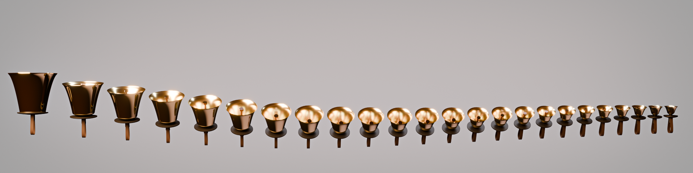

---
title: 'Nodevember 2026 Week 1'
header_image: '/images/nodevember2026/4-brass.png'
...

[Nodevember](https://nodevember.com/) is an annual challenge to make one piece of procedural artwork every day. While the main site isn't updated, Nodevember's Twitter account posted prompts for 2026, and I'm going to try to keep up with them and post notes here.

<!--more-->

Nodevember doesn't define what "procedural art" is, and in fact doesn't have any strong restrictions. It's a personal challenge, not a competition. Practically, it is art made with code or visual scripting, like Blender's geometry nodes and material nodes. Philosophically... well, I don't know what procedural art is, but common themes are:

 * Using rules and mathematical operations instead of doing things "by hand"
 * Using randomness and chance, but restricting it with rules
 * Making "factories" that can build many variations of a single thing

For me, I will define it as making stuff in geometry nodes and material nodes, and avoiding outside models or textures most of the time. 

## Day 1: Origami

Instead of origami, this is a paper snowflake animation. The paper is a dense mesh grid, and the folding is done with successive rotations and translations around a dividing line. This approach is easy to set up, but is slow and sometime ugly.

The "cut" is done on the folded geometry, and what parts of the mesh are cut is remembered with simulation nodes. The "is cut" field is turned into a float and smoothed out before being sent to the material, which removes artifacts from storing the cut in the vertices at the cost of some detail.

Starting with a simple square and bisecting the mesh with each fold might hae reduced artifacts. However, Blender has no built-in bisect node, and I didn't want to try and make one.

## Day 2 - Furniture

Thius is based on a cabinet from Terry Practhett's novel "Making Money", which unfolds from a small piece of furniture into a giant tree-like structure.

Geometry nodes does not (I think) support recursion. Instead, there's a node group that makes one drawer and gives the information needed to make the next one. I tried making it possible to output multiple new drawers, and I definitely think it's possible, but Blender crashed when I tried parsing a list of bundles with a nested for-each loop.

The final render uses multiple randomly-generated "branches" to make the final tree. There's also post-it notes that emulate leaves.

## 3 - Stitch

I've never made good-looking yarn before, but this is the closest I've gotten.

This approach uses many small strands wrapped in a multilayered spiral. In other words, one strand is in a spiral wrapped around a spiral wrapped around another spiral, each bigger than the last. The innermost spiral uses Materials to put flat strands around a cylinder, but the result is still very heavy, at hundreds of thousands of vertices for this render alone.

Each strand has low individual opacity, but the cumulative effect is soft, helped with some blurring and bloom in compositing. The interactions of light through millions of small fibers might be better represented with the Principled Hair BSDF, but I couldn't get that to work.

## 4 - Brass

Hand bells' clappers can only move on one axis, and seem to have springs and dampeners inside the bell (not included). Each bell in the render represents a different pitch and a different stage of an animation I made for ringing the bell.

I've wanted to make a MIDI-to-Blender pipeline for some time, but not today.

## 5 - Clockwork

Every gear uses the same node group. I'd have liked to include more kinds of gears, like worm gears, but didn't really have time.
