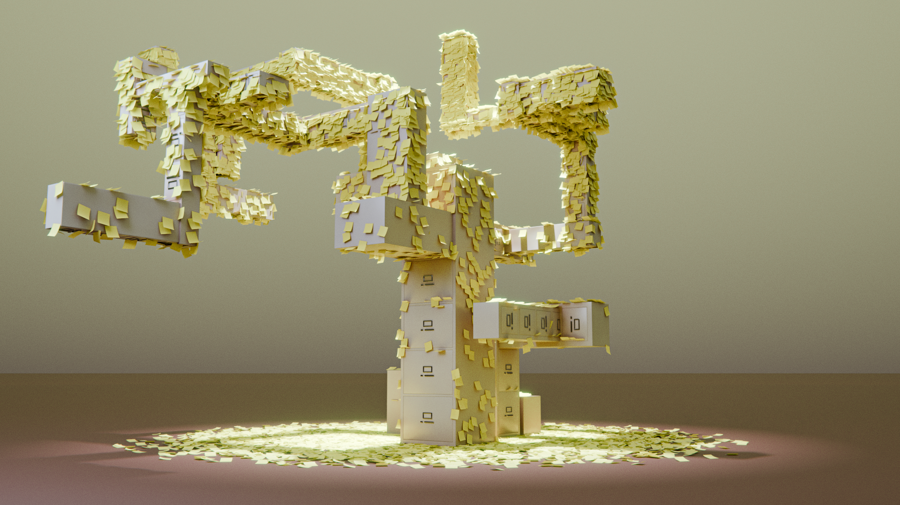
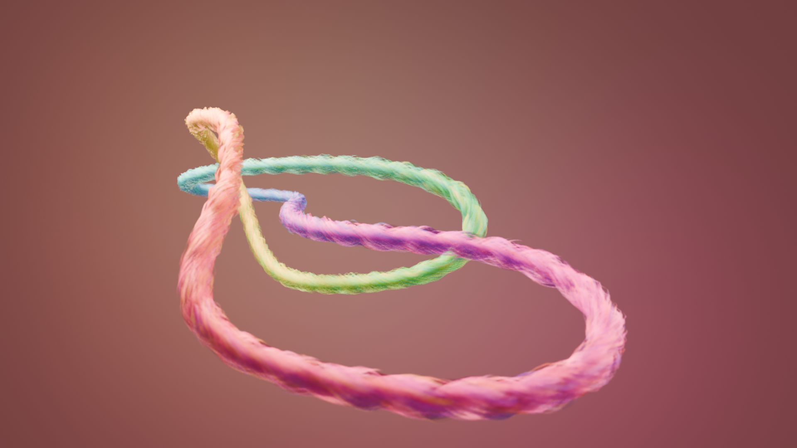
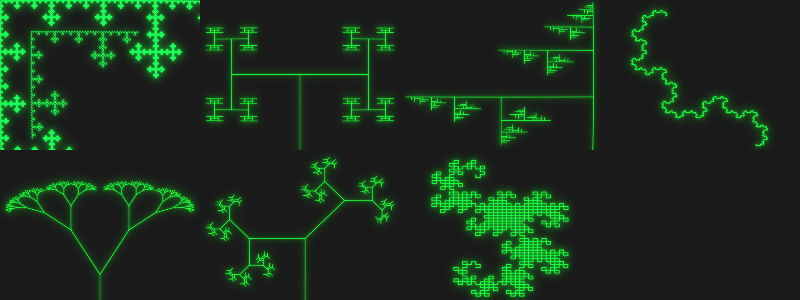
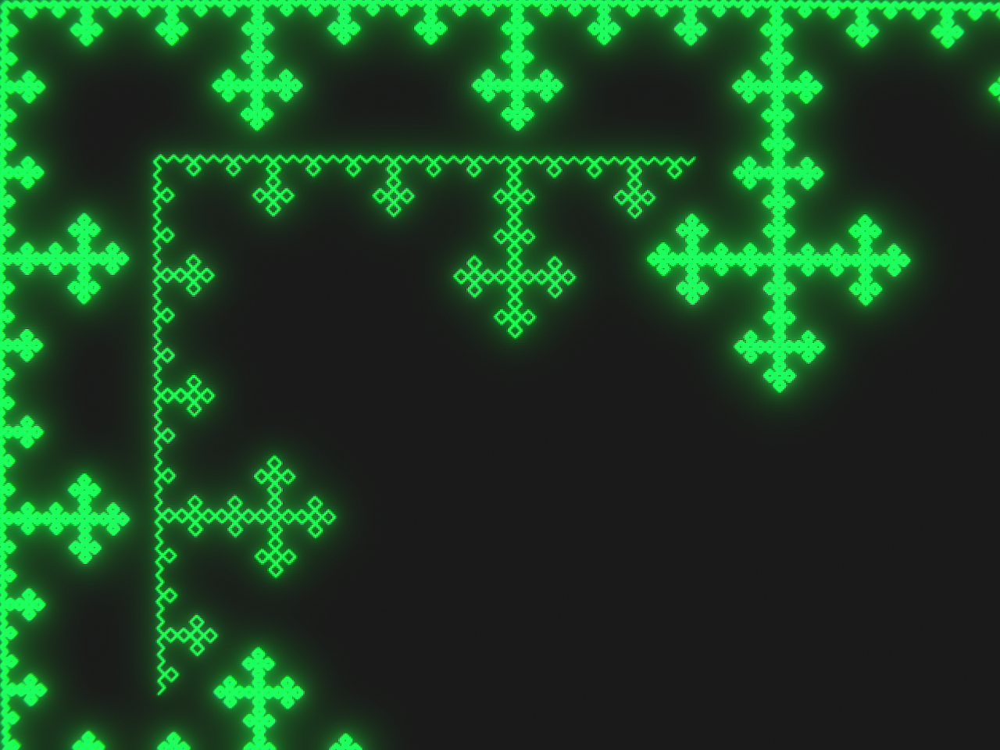
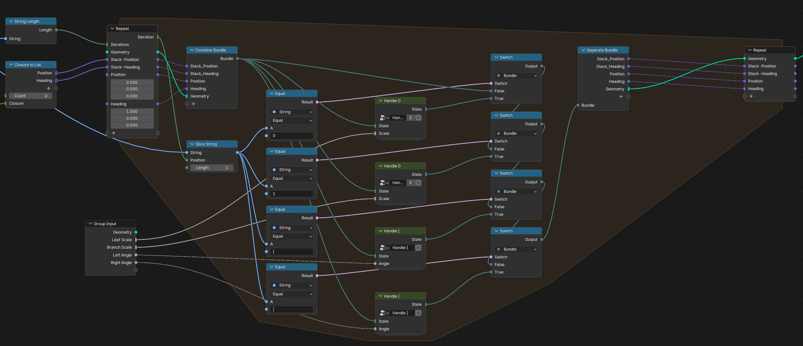

---
title: 'Nodevember 2026 Week 1'
header_image: '/images/nodevember2026/4-brass.png'
...

[Nodevember](https://nodevember.com/) is an annual challenge to make one piece of procedural artwork every day. While the main site isn't updated, Nodevember's Twitter account posted prompts for 2026, and I'm going to try to keep up with them and post notes here.

<!--more-->

Nodevember doesn't define what "procedural art" is, and in fact doesn't have any strong restrictions on what you can make. It's a personal challenge, not a competition. Practically, procedural art is art made through some kind of code, like Blender's geometry nodes and material nodes. More philosophically, it feels more like a collection of themes than anything:

 * Using rules and mathematical operations instead of "hand-placing" elements
 * Using controlled randomness to make decisions
 * Making "factories" that can build many versions of a single thing from some parameters

For me, I'll try to avoid using outside models or textures, and make everything in Godot, Blender, or some other application.

## Day 1: Origami


The prompt says "origami", but I can barely do origami in real life, so I went with something I can do: crude paper snowflakes. The paper is a dense mesh grid, and the folding is done by rotating vertices around a dividing line, pushing them up slightly to model the paper's thickness. This approach is easy to set up, but is slow to calculate and can have ugly artifacts.

The "cut" is done on the folded geometry, and what parts of the mesh are cut is remembered per-vertex with simulation nodes. An "is cut" field is turned from a boolean into a 0-1 float and smoothed out between neighboring vertices before being sent to the material to render. Since the field is smoothed and interpolated between vertices, the resulting cut lines have no jagged artifacts at the cost of losing detail.

## Day 2 - Furniture



This is based on a cabinet from Terry Practhett's novel "Making Money", which unfolds from a small drawer into a giant tree-like structure. Out of one drawer comes a series of smaller drawers, and when you open one of those, you get more drawers, and so on... in other words, it's a recursive cabinet.

Geometry nodes does not directly support recursion. Instead, the node group that makes one drawer also gives the information needed to make the next one. On my version of Blender, passing a list of bundles into a repeat zone causes a crash, so it wasn't practical to make a cabinet have more than one open drawer.

The final render uses multiple randomly-generated "branches" to make the final tree. There's also post-it notes that emulate leaves.

## 3 - Stitch



This is my best attempt at good-looking yarn, although I don't think it's really there yet.

This approach uses many small strands wrapped in a multilayered spiral. One strand of yarn is in a spiral wrapped around a spiral wrapped around another spiral, each spiral bigger than the last. The innermost spiral uses a Material to put flat strands around a cylinder, but the result is still very polygon-heavy, with hundreds of thousands of vertices for this render alone.

Each strand has low individual opacity, so the cumulative effect is soft, helped with some blurring in compositing. The interactions of light through millions of small fibers might be better represented with the Principled Hair BSDF, but I couldn't get that to work.

## 4 - Brass


Some hand bells are made of brass. Hand bells' clappers can only move on one axis, and seem to have springs and dampeners inside the bell for better control. Each bell in the render comes from the same node group with different handle sizes, bell diameters, and progress through a "ringing" animation.

## 5 - Clockwork


Every gear is made from the same node group, and should have the right rotational speed, diameter, and tooth count.

## 6 - Vault


I made this in Godot, which I am still not that familiar with.

The idea was to make a "pole vaulting" game with a physics-simulated pole, but making the pole work at all took quite awhile, and the result is that you can't really vault at all.

The pole is made out of 8 small rigidbodies, each rigidbody pin-jointed with its neighbor. Pin joints try to keep their nodes at the same distance from one another without limiting their rotation, so this would normally make something like a rope. Preventing the joints from bending too much should lead to something like a pole.

I first tried using the pin joint's "motor" to rotate each segment towards the center, like a spring, but this proved frustrating. Making it too weak did nothing. Making it too strong caused the simulation to "explode", with each point flying off in a random direction. If set just right (and with tweaking on the mass and damping of each point as well as overall gravity), it would sag dramatically, start to recover, and then enter a violent and persistent wobble until it eventually exploded.

Pin joints also have settings for minimum and maximum angle. I ignored these at first because I assumed they'd be too rigid, but in fact, they're not rigid at all, and have most of the same issues as the motor approach.

Eventually, I switched to the third-party Rapier physics engine. Compared to everything else in this project, switching physics engines (something that sounds like a tremendous hassle) was completely painless. It didn't solve my problems immediately, but by switching the rigidbody type to "multibody", the situation vastly improved and I had something that more or less behaved like a pole.

There was still some very odd behavior. The pole still had a tendency for violent explosion if bent too much. If the head of the pole was a *static* physics body, then everything was fine, but if it was a rigid body, then the pole would fold in on itself, and if it were a *kinematic* physics body, then there was an immediate explosion. The system was on the very edge of stability.

The only other interesting bit is that the project is in 2D and 3D at the same time. In other engines, the 2D assets would just be placed in the 3D world on a flat plane, but in Godot, the 2D elements are screen-space -- their positions are defined in pixels, not in "world units". This means the scene has a 2D and 3D camera, both of which are moved with the player at the same time.

When it comes to physics, I'm using a system I don't really understand or have a good way to understand. Because of this, trying to find a solution came down to trying things at random and being frustrated at the lack of results. It's possible that I was simply misusing something and "fixed" things by enabling features that were actually not necessary.

## 7 - Tree



[L-systems](https://en.wikipedia.org/wiki/L-system) are a machine that generate complicated results from simple rules. They technically operate on strings of characters, you can interpret that string as a series of instructions for drawing graphics.

For example, an L-system might have a rule that replaces the letter `F` with the text `F+F-F-F+F`, not replacing the characters `-` and `+`. The system starts with just the letter `F` and iterates on the string a few times, resulting in:

```
F
F+F-F-F+F
F+F−F−F+F+F+F−F−F+F−F+F−F−F+F−F+F−F−F+F+F+F−F−F+F
...
```

And so on. To make a graphic out of this, we interpret each character in the string as an instruction, left-to-right: "F" means "go forward and draw a line", "+" means "turn right", and "-" means "turn left". After 5 iterations, we get patterns that look like this;



You can use this sytem to make trees and fractals. The six images above use three L-systems, all copied from Wikipedia, with some tweaked parameters. The resulting curves are converted to grease pencil strokes for quality.

Everything is done in Geometry nodes. I couldn't really tell you why - running an L-system requires lots of string parsing, which geometry nodes is not great at, and interpreting an L-system requires lots of imperative state updates, which geometry nodes can do but, but not with elegance.

The best pattern I've found to draw the L-system is to put all of your state into a bundle and have a different node group for each character you handle, using lots of switch nodes to choose which node gruop to forward to the next loop of the repeat zone.



## Conclusion

I'm going to release one of these every week until the end of November, assuming I can keep up. The previous years had one prompt every two days, which gave you a lot more time for polish and conceptualization.

If, for some reason, you want to do something like this, you will get quite good at executing small projects very quickly. I'm not sure how those skills transfer to projects that take weeks or months, but having a good idea of exactly how much you can get done in ~4 hours is a useful skill. That said, I learned the most from the Vault project, which took a ton of time and produced results that didn't look impressive, so maybe don't limit yourself to what you know you can get done.
