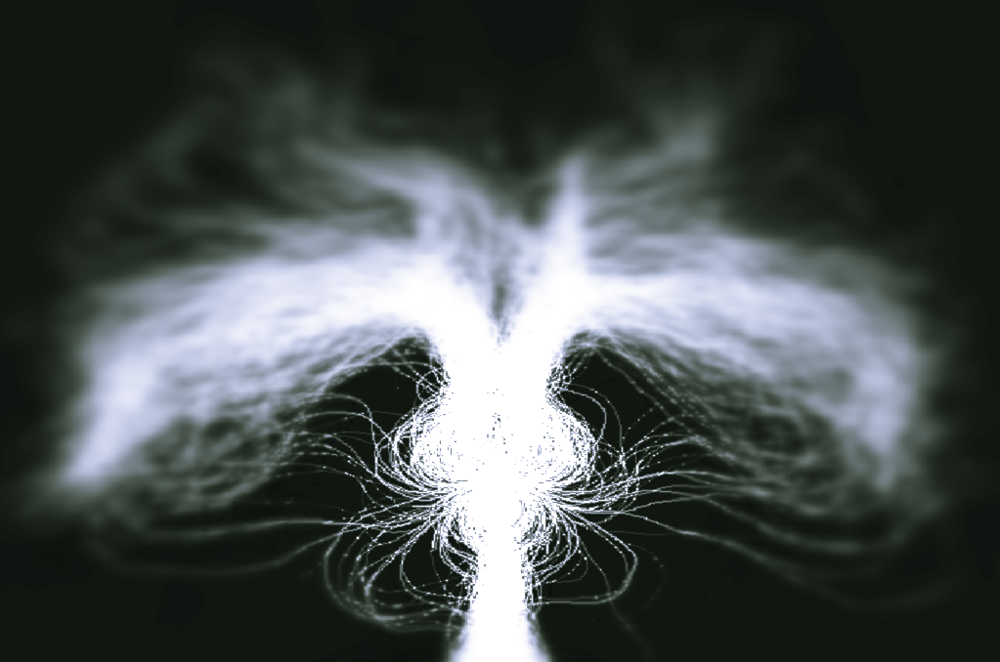
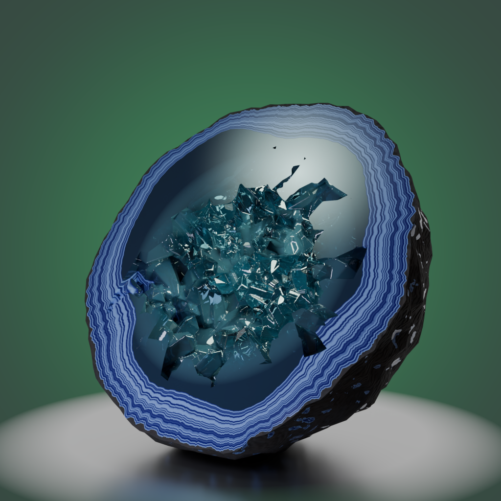
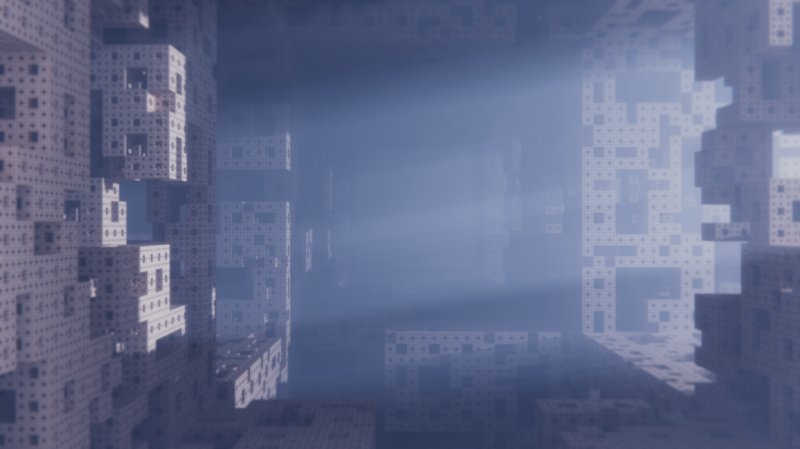
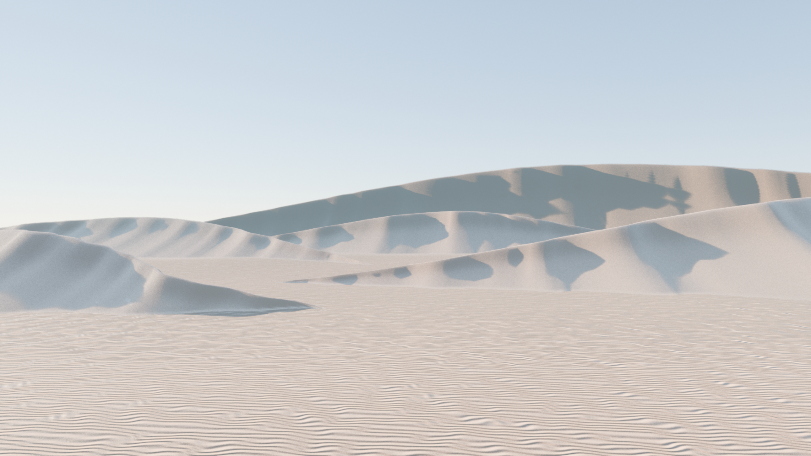
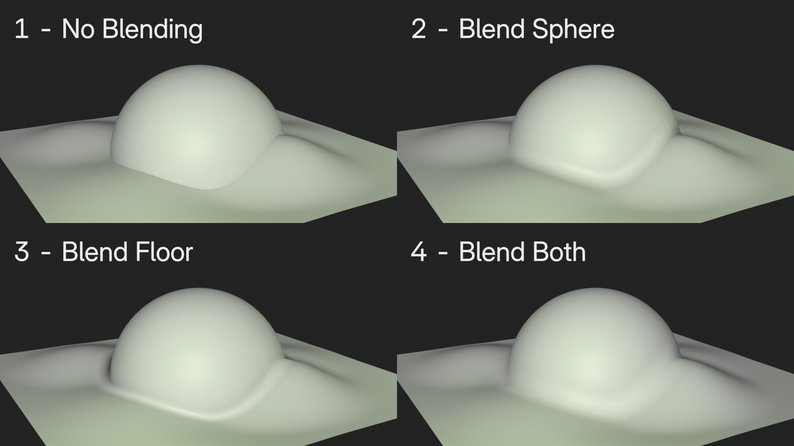
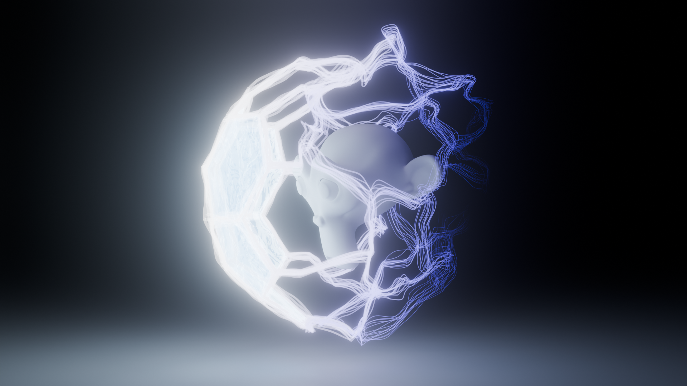

---
title: 'Nodevember 2026 Week 2'
header_image: '/images/nodevember2026/11-cavernous.png'
...

[Nodevember](https://nodevember.com/) continues!  If you missed last week, check it out [here](/posts/2026-11-01-nodevember.html).

<!--more-->

If you're viewing this on Neocities, videos won't show up. Go to [https://theben27.github.io/](the Github site).

## Day 8:-9 Mycelia, Wings

This was made with Godot.

Mycelia are the hair-like root systems of mushrooms. One mushroom can have thousands of thin tendrils or a few larger roots. To get a mycelia-like effect, I simulated the growth of thousands of hairs by tracking the position and heading of their endpoints, following a few simple rules:

 * A new hair spawns from a central position with a random direction ten times a second
 * Hairs move forward on every frame, leaving a trail behind on a canvas
 * Hairs have a limited lifetime, and the trail becomes fainter as they get older
 * Hairs slightly change their heading at random on every update
 * Hairs partially align their headings to follow a pre-made "direction map" (made in Blender)
 * Hairs have a small chance to create a new "branch" hair at their position with a similar but not identical heading on every update

The mycelia were simulated on the GPU through compute shaders, which leads to some unusual restrictions. A CPU program is *mostly* sequential, and is invoked once. In contrast, a GPU program is invoked thousands or millions of times with different parameters and a high degree of concurrency. The GPU has fewer capabilities than the CPU, but is much faster for certain problems, with thousands of cores and built-in SIMD vectorization.

The GPU has no heap or dynamic memory; memory for hairs has to be allocated in advance. This makes arbitrarily creating hairs (for branching) and deleting them (when their lifetime ends) require an [object pool](https://gameprogrammingpatterns.com/object-pool.html) with a free list. This works, but GPUs have no locks, so making adding/removing particles to the pool "thread-safe" seems difficult. I decided to use an atomic "pool in-use" parameter and have the create/delete operations fail if it's in use. You can try again next frame.

To paint to the canvas, hairs just paint the pixel they're on, with opacity based on lifetime. This makes hairs often skip pixels or double-paint the same pixel, but a better solution would be more time-consuming.

The final image includes post-processing in the GIMP image editor, which is a little cheaty.

## Day 10: Geode

This one's not so great.

## Day 11: Cavernous

This is a [Menger sponge](https://en.wikipedia.org/wiki/Menger_sponge) with a chance for a cube to be deleted on each iteration, making the shape less regular and more broken down. The sponge has 7 levels, although the last two levels are faked in the Material.

## Day 12: Erosion

Despite being an underwhelming effect, this took a lot of effort!

I decided to see what happens when you apply JPEG compression too a mesh's position. For fake JPEG compression of non-color data, you only really need three steps:

1. Split the image into 8x8 boxes and convert each box into the frequency domain with a Discrete Cosine Transform (DCT)
2. Quantize (reduce the decimal places of) higher-frequency values more than lower-frequency ones
3. Put the image back into the space domain with an inverse DCT

The "frequency domain" is a signal processing idea. In short, we can represent the 8x8 box of one channel of values exactly via 64 (8x8) products of horizontal and vertical cosine waves of consistent frequenices and phases but different amplitudes. High-frequency waves correspond to details, and low-frequency waves correspond to bigger blobs. High-frequency waves are less "important" to the human eye, which is why JPEG gives low-frequency waves more precision.

DCT scales very poorly with size, which I suspect is why JPEG has DCT operate on 8x8 blocks. Blender took a few seconds to process a 2000-vertex mesh, which is not big in the grand scheme of things.

Instead of running the DCT on an image, we're running it on a mesh's vertex positions. Vertex positions are ordered by index, so they're one-dimensional data. I decided to use a [Hilbert curve](https://en.wikipedia.org/wiki/Hilbert_curve) to convert the 1D list into a 2D grid and back. So now the full process is:

1. Convert the 1D field into a 2D grid with a hilbert curve
2. DCT on each 8x8 section of the grid
3. Quantization
4. Inverse DCT on each 8x8 section
5. Convert the grid back into a field
6. Set the position based on that

This approach required a lot of bugfixing and optimizing.  I found that using Grids to store information worked well, and used the Bake node to keep from having to recalculate everything on every update.

If I could do this again, I'd convert the mesh to a 3D grid and run 8x8x8 DCT, which would probably give more interesting results at the cost of taking *much* longer to run.

I used these sources to make nodes for DCT, inverse DCT, and hilbert curve transformations:

 * [DCT - MathWorks](https://www.mathworks.com/help/images/discrete-cosine-transform.html)
 * [Hilbert Curve - University of South Carolina](https://people.math.sc.edu/burkardt/cpp_src/hilbert_curve/hilbert_curve.html)

## Day 13: Dune

Each dune is a separate object that gets blended into the ground through [this technique](https://www.youtube.com/watch?v=RCQAwDyDO0o). The vertices of the dune close to the ground have their normals bent to match the ground's. This trick depends heavily on the geometry and material properties of the objects you're blending.

If you want to do this yourself, I recommend trying different kinds of blending to get the right results. You can also have each object blend into each others' normals; if you do, have the maximum blending be 50% so they fade into a midpoint.

There is a much better approach for blending called [MeshBlend](https://meshblend.lervik.com/), but I think it'd require doing all of your lighting in the compositor and making some complicated node groups.

## Day 14: Shell

It's some kind of forcefield.
